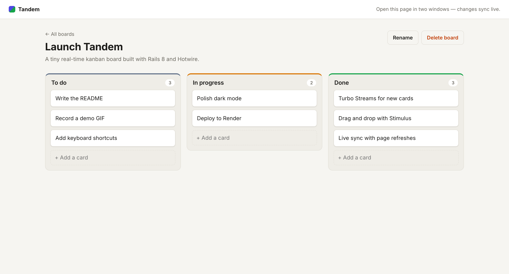
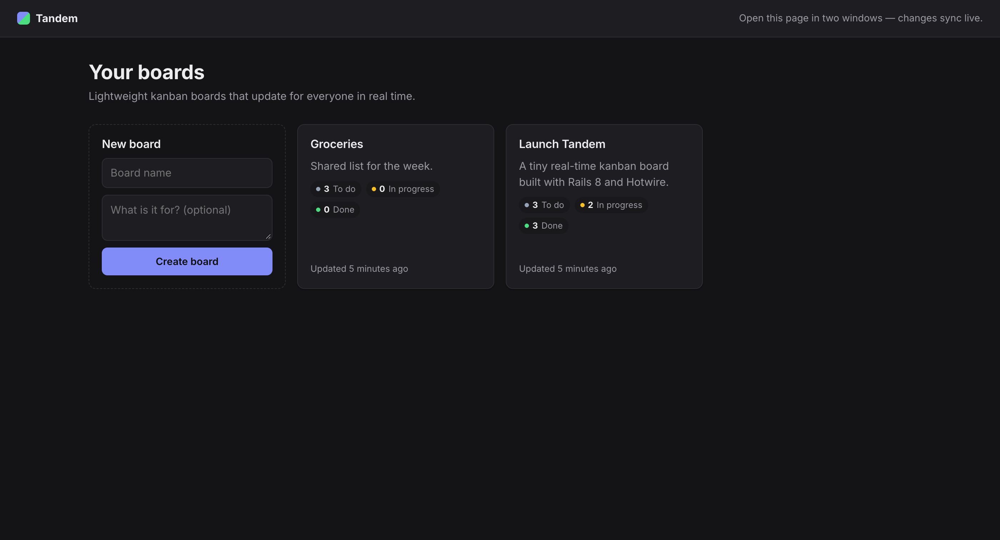
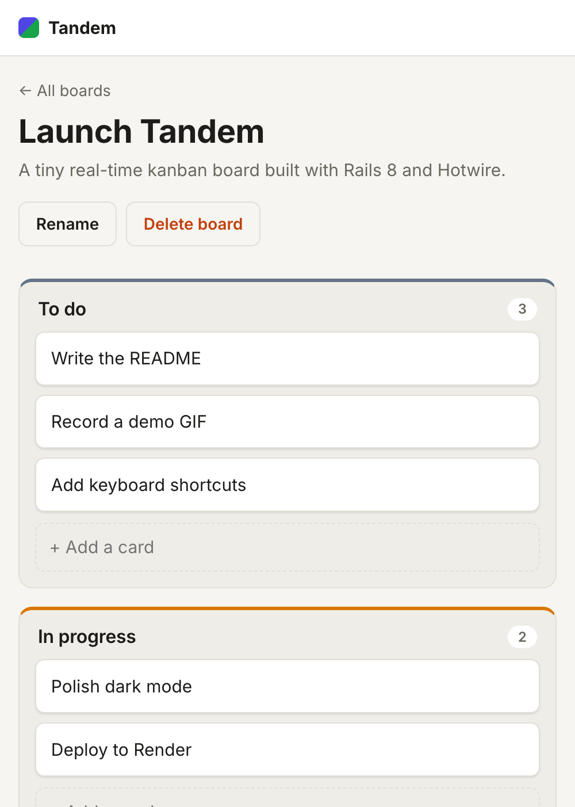

# Tandem

A tiny real-time kanban board built with **Rails 8** and **Hotwire** (Turbo + Stimulus) — no React, no build step, no CSS framework.

Open a board in two browser windows: add, edit, drag or delete a card in one and the other updates instantly.



| Boards (dark mode) | Mobile |
| --- | --- |
|  |  |

## How the Hotwire pieces fit together

| Feature | Technique | Where |
| --- | --- | --- |
| Add / delete a card without a reload | **Turbo Streams** responses (`append`, `replace`, `remove`) | `app/views/cards/*.turbo_stream.erb` |
| Inline editing of cards and board name | **Turbo Frames** — the edit form loads into the card's own frame | `app/views/cards/_card.html.erb`, `edit.html.erb` |
| Live multi-user sync | **Turbo 8 page refreshes with morphing**, broadcast over Action Cable via `broadcasts_refreshes` | `app/models/board.rb`, `card.rb`, layout `turbo_refreshes_with` |
| Drag and drop between columns | **Stimulus** controller using native HTML5 drag events and `Turbo.fetch` | `app/javascript/controllers/sortable_controller.js` |
| No echo for the person making the change | Turbo's request-id header means the originating tab ignores its own refresh broadcast | built in to Turbo 8 |

Other details:

- Cards keep a contiguous `position` per column; `Card#move_to` reorders inside a transaction.
- Server-side refresh broadcasts are debounced, so dragging a card that renumbers a whole column sends one refresh, not ten.
- Light and dark themes via `prefers-color-scheme`, responsive down to phone width.
- Importmap + Propshaft: the JavaScript ships as-is, no bundler.

## Running it

Requires Ruby 4.0 and SQLite.

```sh
bin/setup          # installs gems, prepares and seeds the database, starts the server
# or
bin/rails db:prepare db:seed
bin/dev
```

Then visit <http://localhost:3000> and open the same board in a second window.

## Tests

```sh
bin/rails test:all   # model, controller and headless-Chrome system tests
bin/rubocop
bin/brakeman
```

The system tests cover adding a card via Turbo Streams (asserting no full page load), inline editing, drag and drop persistence, and live sync between two separate browser sessions.
